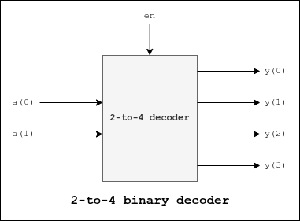

# 2-to-4 Binary Decoder

## Description
Decodes a 2-bit binary input into one 4-bit output with an enable signal.

## I/O Ports
| I/O | Port | Description |
| ----------- | ----------- | ----------- | 
| *Input* | **en** | Enable signal |
| *Input* | **a[1:0]** | Generic 2-bit signal |
| *Output* | **y[3:0]** | 4-bit decoded signal |

## Block Diagram
