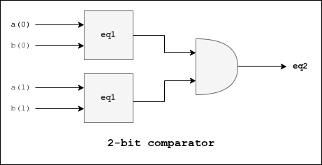

# 2-bit Comparator

## Description
Compares two 2-bit signals.

## I/O Ports
| I/O | Port | Description |
| ----------- | ----------- | ----------- | 
| *Input* | **a[1:0]** | Generic 2-bit signal |
| *Input* | **b[1:0]** | Generic 2-bit signal |
| *Output* | **eq2** | Comparator output |

## Block Diagram
