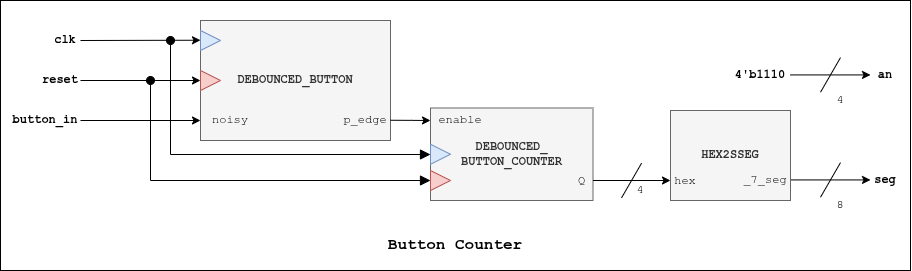

# Button Counter

## Description
Counts how many times a button is pressed (0-F), then it reset the counter. The counter implements a debounced and edge detected output.

## I/O Ports
| I/O | Port | Description |
| ----------- | ----------- | ----------- | 
| *Parameter* | **N** | N-bits (**default value**: 4) |
| *Input* | **clk** | Clock signal |
| *Input* | **reset** | Reset signal |
| *Input* | **button_in** | Button signal |
| *Output* | **an[3:0]** | 4-bit anode vector for 7-segment display |
| *Output* | **seg[7:0]** | 7-bit signal display value |

## Block Diagram
