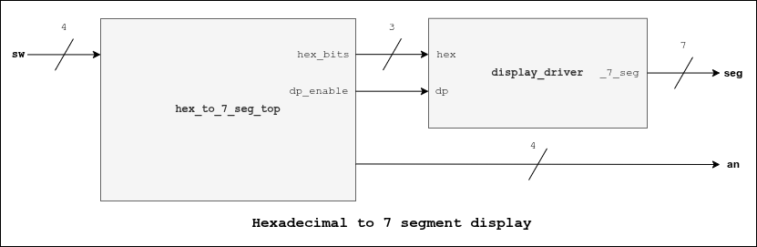

# Hexadecimal to 7-Segment

## Description
Converts the hexadecimal signal comming from the switch and displays it into the 7-segment display. Last MSB from sw signal enables/disables decimal point.

## I/O Ports
| I/O | Port | Description |
| ----------- | ----------- | ----------- |
| *Input* | **sw[5:0]** | 5-bit hexadecimal input signal |
| *Output* | **an[3:0]** | 4-bit anode vector for 7-segment display |
| *Output* | **seg[7:0]** | 7-bit signal display value |

## Block Diagram
