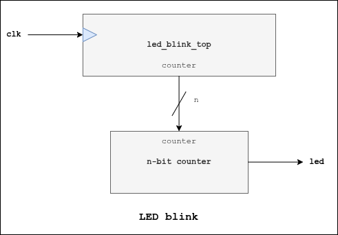

# LED Blink

## Description
Blinks a LED every second.

## I/O Ports
| I/O | Port | Description |
| ----------- | ----------- | ----------- | 
| *Parameter* | **MAX_COUNT** | Maximum clock count (**default value**: 50_000_000)
| *Input* | **clk** | Clock signal |
| *Output* | **led** | LED signal |

## Block Diagram
