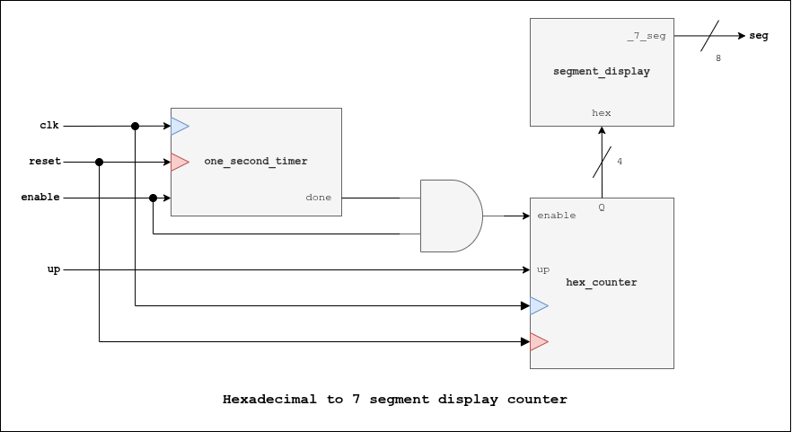

# Hexadecimal Segment Counter

## Description
Counts all the way up from 0 to F hexadecimal value with **enable** and **up/down**. It refreshes every second.

## I/O Ports
| I/O | Port | Description |
| ----------- | ----------- | ----------- | 
| *Parameter* | **FINAL_VALUE** | Maximum clock count (**default value**: 99_999_999)
| *Input* | **clk** | Clock signal |
| *Input* | **reset** | Reset signal |
| *Input* | **enable** | Enable signal |
| *Input* | **up** | When asserted the counter is up, else it counts down |
| *Output* | **an[3:0]** | 4-bit anode vector for 7-segment display |
| *Output* | **seg[7:0]** | 7-bit signal display value |

## Block Diagram
