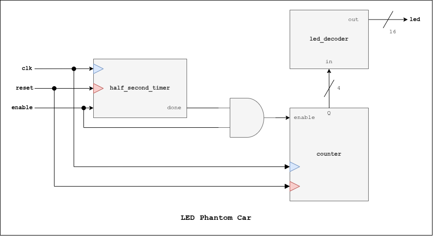

# LED Phantom Car

## Description
Does the phantom car effect with the LEDs.

## I/O Ports
| I/O | Port | Description |
| ----------- | ----------- | ----------- | 
| *Parameter* | **FINAL_VALUE** | Maximum clock count (**default value**: 99_999_999) |
| *Parameter* | **N_counter** | N-Bits for the counter (**default value**: 4)
| *Parameter* | **N_led** | Size of LED vector (**default value**: 16)
| *Input* | **clk** | Clock signal |
| *Input* | **reset** | Reset signal |
| *Input* | **enable** | Enable signal |
| *Output* | **led[N_led-1:0]** | LED vector |

## Block Diagram
