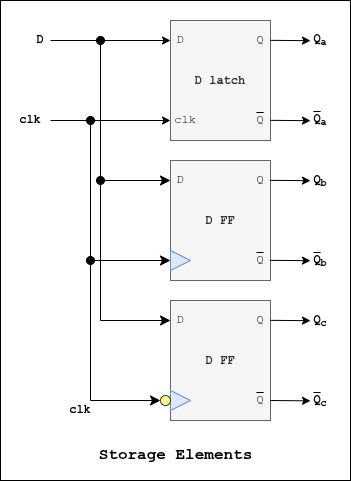

# Storage Elements

## Description
Containts a **D-latch**, **D FF positive** and **D FF negative**.

## I/O Ports
| I/O | Port | Description |
| ----------- | ----------- | ----------- |
| *Input* | **D** | Data signal |
| *Input* | **clk** | Clock signal |
| *Output* | **Qa** | D-latch output|
| *Output* | **Qb** | D FF negative output|
| *Output* | **Qc** | D FF positive output|

## Block Diagram
